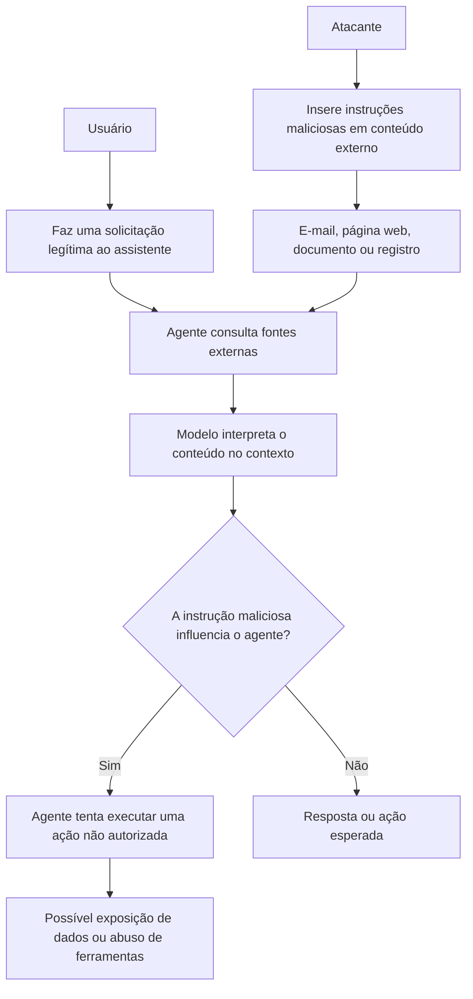
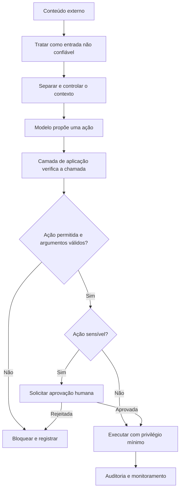

# Prompt Injection: quando o contexto vira vetor de ataque

[](LICENSE)
[](prompt_injection.tex)

Um artigo técnico sobre **Prompt Injection** e os riscos de segurança introduzidos por aplicações que utilizam modelos de linguagem e agentes de IA. O texto explora como instruções maliciosas podem ser incorporadas a conteúdos aparentemente comuns e, posteriormente, interpretadas por um modelo como comandos legítimos.

O artigo dá atenção especial à **injeção indireta de prompt**, aos incidentes divulgados envolvendo grandes plataformas de IA e aos desafios de proteger agentes que acessam dados, ferramentas e serviços em nome de seus usuários.

> **Título do artigo:** *O dia em que o convite de calendário virou ordem*  
> **Subtítulo:** Como a injeção de prompt saiu dos laboratórios e passou a mirar os sistemas das grandes plataformas — e por que elas não conseguem simplesmente “corrigir” o problema.

## Acesso ao artigo

- **[Ler o artigo em PDF](prompt_injection.pdf)**
- [Consultar o código-fonte em LaTeX](prompt_injection.tex)

## Sobre o conteúdo

O artigo parte de um problema central: modelos de linguagem podem receber, dentro do mesmo contexto, instruções confiáveis e conteúdo externo não confiável. Quando essa fronteira não é devidamente controlada, um texto inserido em uma página, e-mail, documento ou registro externo pode influenciar o comportamento de um agente.

O texto aborda os seguintes pontos:

- **Fundamentos:** por que a distinção entre instruções e dados externos é um desafio para aplicações baseadas em LLMs.
- **Prompt Injection indireta:** como conteúdos contaminados podem chegar ao modelo sem que o atacante interaja diretamente com o assistente.
- **Casos reais divulgados:** exemplos envolvendo ferramentas e plataformas como Gemini, Microsoft Copilot, Salesforce Agentforce e agentes de desenvolvimento.
- **Impactos para as plataformas:** exposição de dados, abuso de permissões, confiança corporativa, custos de defesa e questões regulatórias.
- **Estratégias de mitigação:** privilégio mínimo, isolamento de contexto, validação de chamadas de ferramentas, supervisão humana e testes adversariais.

## Como funciona um ataque indireto?

O fluxo abaixo ilustra, de forma simplificada, como uma instrução maliciosa pode ser transportada por uma fonte externa e alcançar um agente de IA durante uma tarefa legítima.



**Importante:** o diagrama representa um cenário conceitual. A exploração depende da arquitetura, das permissões, dos controles e do comportamento específico da aplicação.

## Defesa em camadas

Não existe uma instrução mágica no prompt capaz de eliminar esse risco. A proteção precisa ser aplicada principalmente na arquitetura que envolve o modelo: permissões restritas, verificações fora do LLM e controle sobre o uso de ferramentas.



Entre as medidas discutidas no artigo estão:

- Conceder ao agente somente as permissões necessárias para a tarefa.
- Validar chamadas de ferramentas e seus argumentos no código da aplicação, sem delegar essa decisão exclusivamente ao modelo.
- Exigir confirmação humana para operações sensíveis ou irreversíveis.
- Controlar quais fontes podem alimentar mecanismos de busca e recuperação de contexto.
- Monitorar ações, registrar eventos e realizar avaliações adversariais contínuas.

## Estrutura do repositório

```text
Prompt-Injection/
├── LICENSE
├── README.md
├── prompt_injection.pdf
└── prompt_injection.tex
```

| Arquivo | Descrição |
|---|---|
| `prompt_injection.pdf` | Versão compilada do artigo, pronta para leitura. |
| `prompt_injection.tex` | Código-fonte LaTeX utilizado para produzir o documento. |
| `LICENSE` | Licença MIT do repositório. |

## Compilar o documento

O artigo foi escrito em LaTeX. Para gerar o PDF localmente, é necessário ter uma distribuição LaTeX instalada, como TeX Live, com os pacotes utilizados pelo documento.

Com `latexmk`:

```bash
latexmk -pdf -interaction=nonstopmode prompt_injection.tex
```

Ou diretamente com `pdflatex`:

```bash
pdflatex prompt_injection.tex
```

A compilação gera `prompt_injection.pdf` no diretório do projeto.

## Referências

As fontes consultadas estão relacionadas ao final do próprio artigo. Entre elas estão materiais da [OWASP GenAI Security Project](https://genai.owasp.org/), do [Google Security Blog](https://blog.google/security/), do [Microsoft Security Response Center](https://msrc.microsoft.com/) e de outras publicações e instituições de pesquisa.

O conteúdo do artigo foi redigido como uma síntese autoral das fontes consultadas. Consulte as referências originais para obter o contexto completo de cada pesquisa, vulnerabilidade ou incidente citado.

## Aviso

Este repositório tem finalidade **educacional e informativa**. O artigo não é uma ferramenta de exploração, não implementa mecanismos de ataque ou defesa e não substitui uma avaliação de segurança da aplicação ou do modelo utilizado. Os exemplos devem ser compreendidos no contexto das fontes e das datas indicadas no documento.

## Licença

Distribuído sob a licença [MIT](LICENSE).
